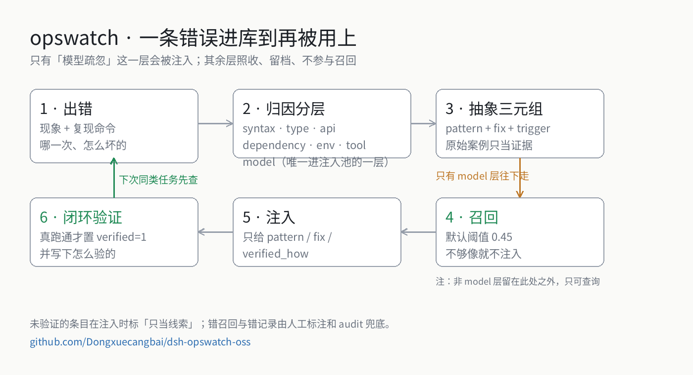

# opswatch · 给 AI 助手用的「干活库」

AI 助手最容易犯的错，不是能力不够，是**同一个坑踩两遍**：
上次构建失败是因为环境变量，这次又去改代码；上次写文档被 shell 吃掉反引号，这次又写花。

这个库把「踩过的坑」和「答错的事」存成结构化数据：开工前查一遍，踩完立刻记一笔。
另附一个 dsh-go 原生插件，把这些数据摆到手机界面上。

> 文中示例都是中性场景，只讲机制。



## 两个库，四张表

`ops.db`（干活）：`gate` 卡点、`fault` 故障模式、`tool` / `playbook` / `step` 工具与流程。
`memory.db`（事实）：`memory` 事实、`evidence` 出处、`regress` 答错过的题。

插件读 `ops.db` 的卡点和故障，读 `memory.db` 的错题；两个库各自 try/catch，一个读不到只少一行，不拖垮状态条。

## 四条设计原则

**1. 错误归因分层。** `fault.layer` 取 syntax / type / api / dependency / env / tool / model / other。
只有 `model` 层（真正属于模型疏忽）才进召回池；其余照收、留档、可查，但不注入。
不分层的话，「编译失败」会把环境问题和模型问题混成一锅。

**2. 存抽象，不存 diff。** `pattern` + `fix` + `trigger_cond` 三元组；原始案例放 `example`，只当证据。

**3. 召回带阈值。** `recall` 默认 0.45，不够像就明说「宁可不注入」。
中文没有分词器，用去虚词后的一元重合率与二元 Jaccard 取大——这是闸门，不是语义理解，所以阈值刻意偏高。
`fault.keywords`（逗号分隔）只用于加分，不会把字面命中多的条目压下去。

**4. 闭环验证。** `verified` 要等修正后真跑通才置 1，并写下 `verified_how`。
`--verified` 不给证据/不写 `--how` 会被自动降级成未验证，防止"自称验证过"。

## 目录

```
sql/ops.sql      gate / tool / playbook / step
sql/fault.sql    fault
sql/memory.sql   memory / evidence / regress（可选）
cli/ops.py       命令行：gate / fault / recall / before / verify / audit
plugin/          dsh-go 原生插件（胶囊、状态条、面板），package.json 的 main 指向 lib/index.js
```

## 用法

```sh
# 记一条卡点：什么时候必须做什么，哪一次坏的
python3 cli/ops.py gate "改配置文件之后" "先跑一次 lint" -w "否则 CI 红" -e "2026-11-26 本机实测" --verified

# 记一条故障模式：只收模型疏忽那层，写成抽象三元组
python3 cli/ops.py fault "用 printf 写文件时反引号被展开" -l model \
  -p "通过 shell 拼装含反引号或 \$ 的文本去写文件" \
  -f "用写入工具整段写，写完读回校验" -t "写文档/配置/代码片段" \
  -k "反引号,shell,写文件" --verified --how "重写后读回行数正常"

# 开工前查卡点；故障模式用 recall 查（before 只管卡点，末尾会提示）
python3 cli/ops.py before 构建
python3 cli/ops.py recall "写文件被吃掉反引号"

# 置为已验证（--fault 时作用于故障模式）
python3 cli/ops.py verify 3
python3 cli/ops.py verify 2 --fault --how "重跑通过"

# 体检：哪条没证据、哪条超期没复核、哪条故障没闭环
python3 cli/ops.py audit
```

环境变量：`OPS_DB` 改数据库路径（默认与 ops.py 同目录的 ops.db）。

## 插件

```sh
dsh plugin --profile web add ./plugin
```

装完输入框上方出现胶囊，状态条显示 `卡点 N · 故障 M · 错题 K`，面板分段列出并标 ✓/?。

环境变量：`OPSWATCH_DB`、`OPSWATCH_MEM`、`OPSWATCH_CLI`，默认都在 `~/.opswatch/`。

## 注意

- 插件只负责显示和递命令，召回与阈值在脚本里算，保证同一套规则。
- **库文件里是个人数据，不入仓库**：只提交 schema，别提交 `.db`。
- 一条卡点必须写清「哪一次、怎么坏的」；没证据就标未验证。
- 写通用产物（README、模板、插件）时，示例用中性场景，个人实例留在本地库。

## License

MIT，见 [LICENSE](LICENSE)。